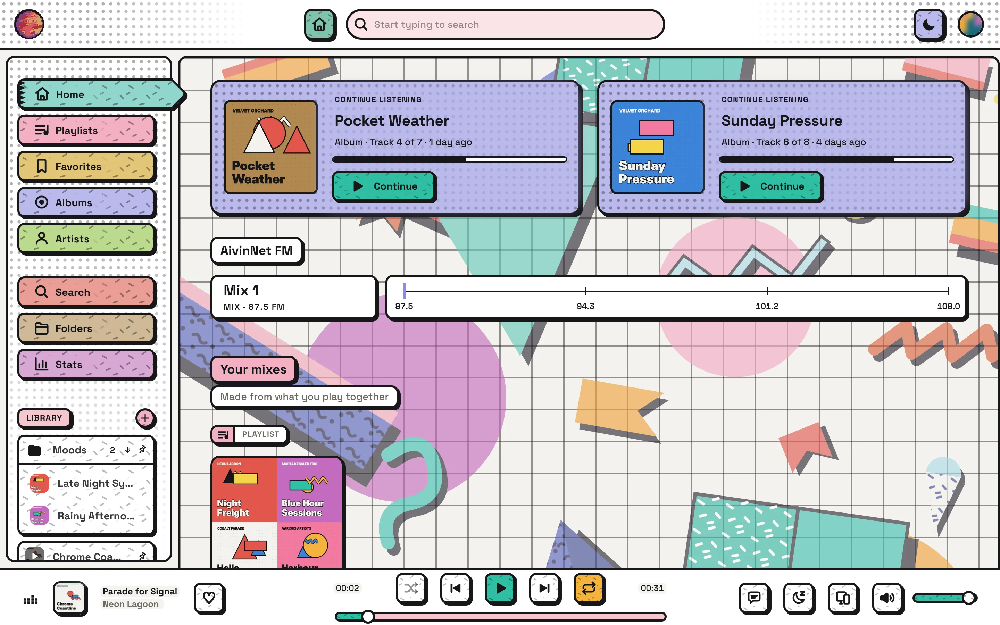
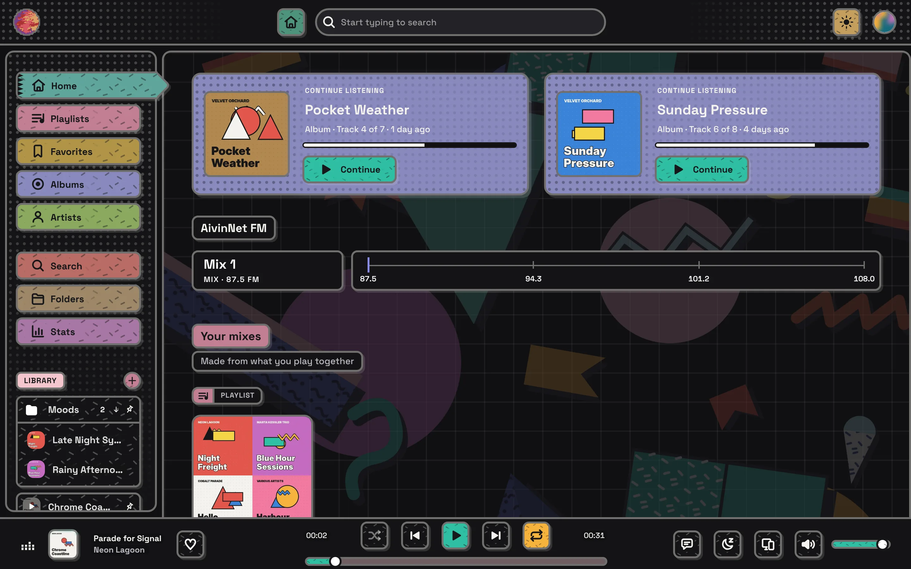
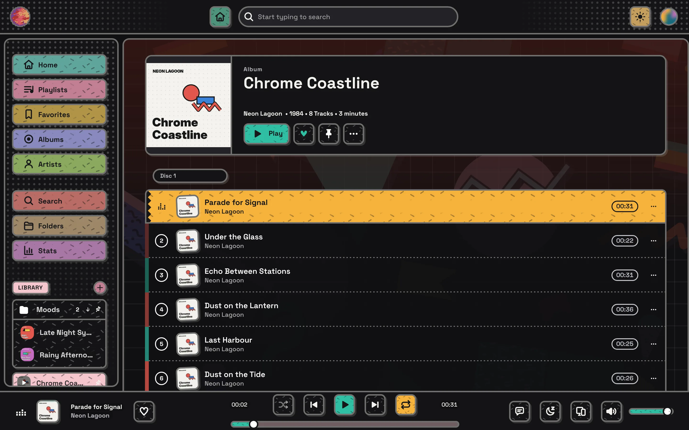
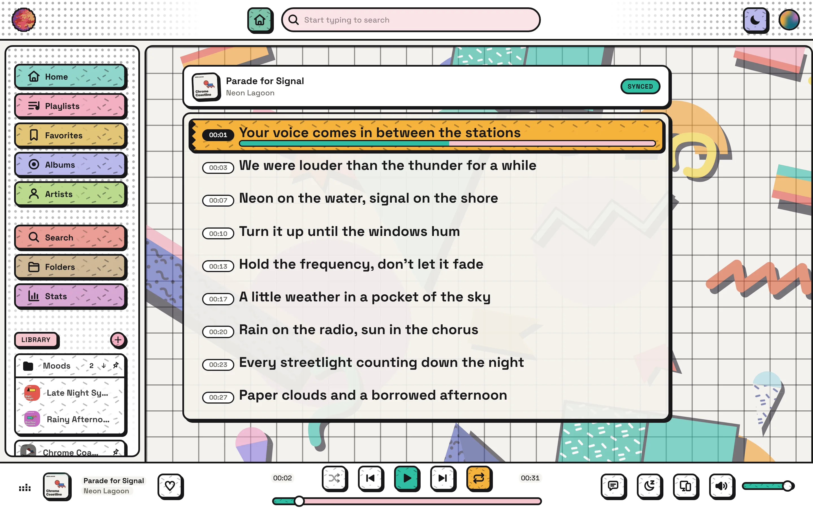
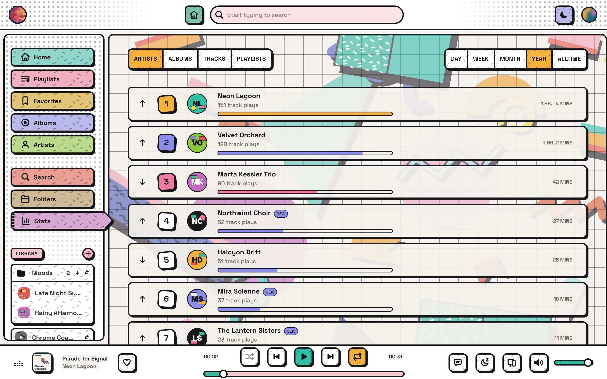
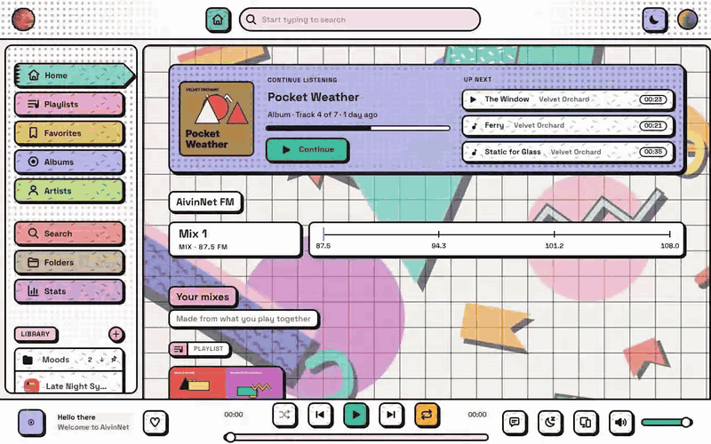
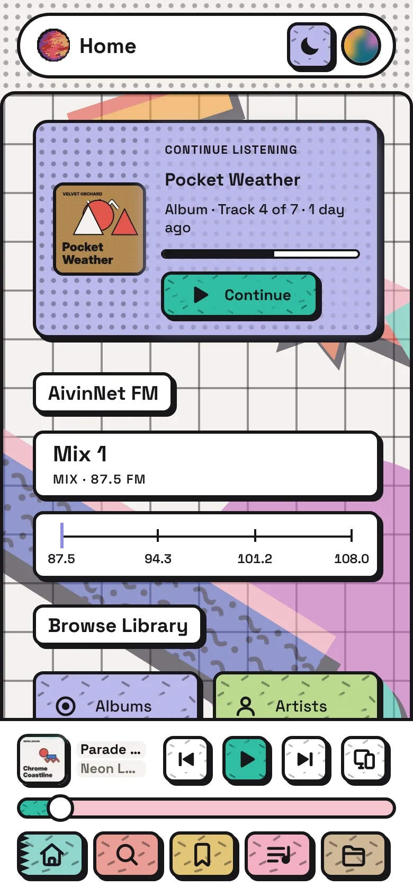
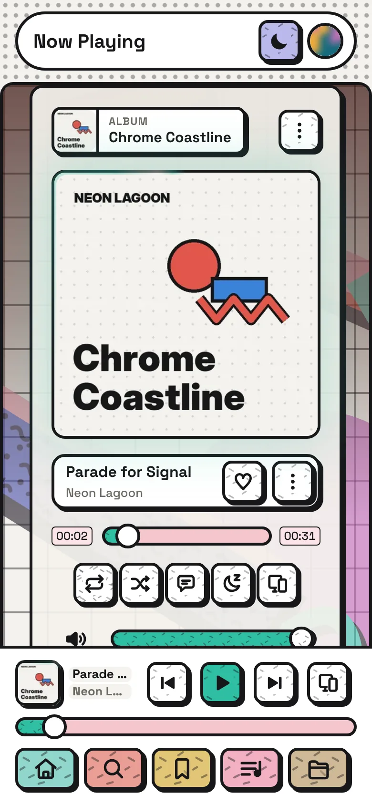
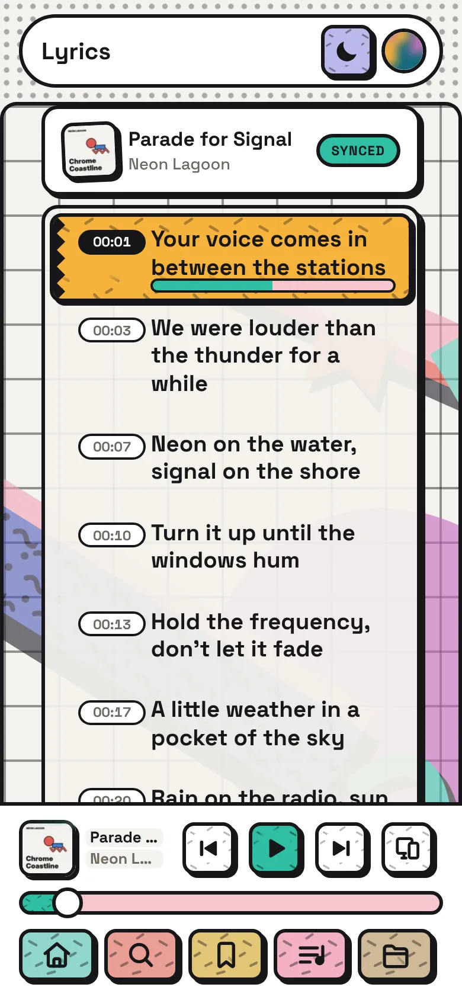
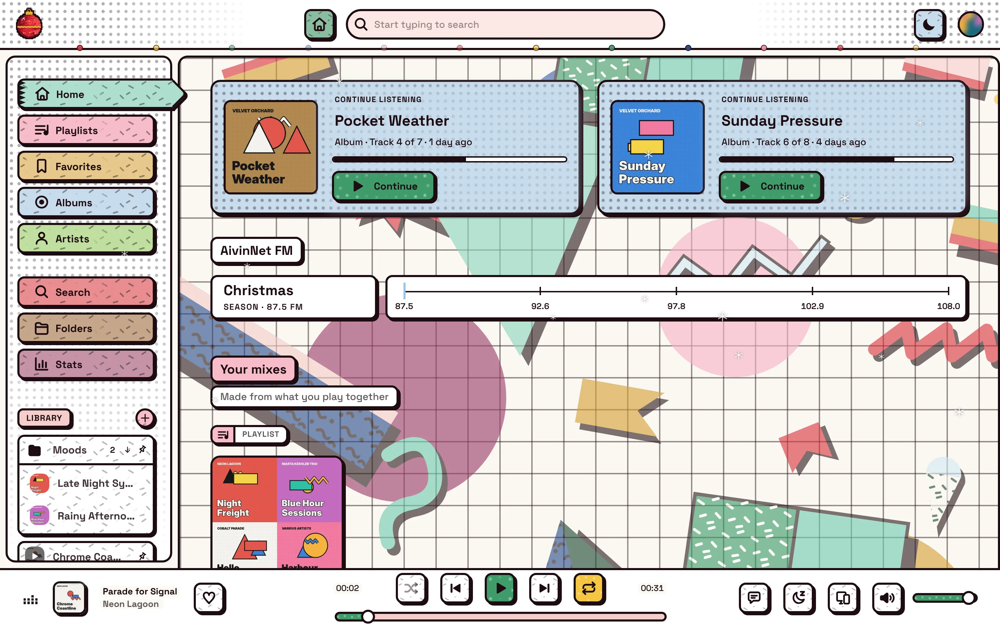

# AivinNet

**Self-hosted music server with a web player of its own**

AivinNet streams your own music library to a web player with a look of its own:
bold 80s/Memphis shapes and colours, in light and dark. Point it at a folder of
music, open it in a browser, and that is the whole idea. Everything it suggests
comes from your own listening, on your own machine.

```sh
curl -fsSL https://raw.githubusercontent.com/vwellenberg/AivinNet/master/install.sh | bash
```

One line on Linux; Docker and the other ways are under [Other install paths](#other-install-paths).



## What it looks like

| | |
| --- | --- |
|  |  |
| **Dark mode**, by hand or automatically in the evening | **Albums** with their tracks, tinted from the cover |
|  |  |
| **Synced lyrics** with a progress bar per line | **Stats**: top artists, albums and tracks, and more |

In motion: from Home to an album, and playing it with its lyrics.

<p align="center"></p>

On the phone it is the same app, laid out for one hand:

<p align="center">
  
  
  
</p>

And now and then it dresses up for the season: Halloween, Christmas (below) and
New Year's Eve, with their own colours, logo and a few things that wander across
the screen. Nothing moves when your system asks for reduced motion.



<sub>All screenshots show a demo library made for them: invented artists, generated
covers, synthetic audio. `scripts/demo/` rebuilds it and takes the pictures.</sub>

## What it does

**Your library**
- Reads the tags into albums, artists and tracks; artist pages split the
  discography by type and collect guest appearances. A folder browser walks the
  tree as it is on disk, for when the tags are not the truth.
- Search over tracks, albums and artists, and an A–Z band for browsing.
- Fix tags in the app, give an album a cover (upload, search online, or write it
  into the files), and give an artist a picture.
- New music arrives with **Scan for new music** in the profile menu; AivinNet
  does not watch the filesystem.

**Home, from your own listening**
- *Continue listening*, *Your mixes* (cut from your own listening sessions),
  *Because you listened to …*, *On repeat*, *Never played*, *Deep cuts*,
  *Forgotten favorites*, *Almost complete*, *On this day* and more. Each user
  picks which rows appear and in what order.
- **AivinNet FM**: a dial on Home that tunes between your mixes, genres and
  decades, plus seasonal stations (Christmas, a New Year's Eve countdown).
- A recap card on Mondays and on the 1st, an Advent calendar in December, and
  **Rewind**, your year in music, which you can save as a story image.

**Playlists and favourites**
- Playlists with covers, pinned to the sidebar and filed into folders; music
  folders and albums can be pinned too.
- **Smart playlists** that fill themselves from rules (genre, artist, year, plays,
  date added, last played, favourite).
- Favourites for tracks, albums and artists, each with a page of its own.

**Playback**
- Gapless, with optional silence skipping and a crossfade you set yourself.
- **ReplayGain** to even out the volume, a **sleep timer** that fades out, and a
  queue you rearrange by dragging (and undo a removal from).
- Synced lyrics from `.lrc` files or embedded tags; the optional lyrics finder
  can fetch missing ones.

**Stats**
- Top artists, albums and tracks per day, week, month, year or all time, with
  trends against the period before.
- A listening calendar and clock, skip rate, records, devices, formats, and how
  much of your library you have explored.

**Several devices, several people**
- **Multiroom**: pair a phone by QR code and play in sync on several devices,
  each of them able to steer.
- Multiple users, each with their own playlists, favourites and history, plus an
  optional guest login.
- Downloads of an album or playlist, as a ZIP or as separate files.
- **Backup and restore** of the whole instance in one file.

**Looks**
- Memphis in light and dark, with four colour schemes (Memphis, Lagune,
  Terrakotta, Eierschale), or a calm *Boring* look.

<details>
<summary>For tinkerers</summary>

- A REST API behind everything the client does.
- An [MCP server](mcp_server/) so an assistant can manage playlists and fix tags
  for you.

</details>

**What it does not do:** transcode. Files are streamed as they are; see
[Audio formats](#audio-formats).

---

## Install (Linux)

```sh
curl -fsSL https://raw.githubusercontent.com/vwellenberg/AivinNet/master/install.sh | bash
```

That downloads the release AppImage for your architecture (x86_64 or aarch64),
verifies its checksum, installs it to `~/.local/bin/aivinnet`, and sets up a
systemd service that comes back after a reboot. It prints the URL and the
generated admin password when it is done.

Requirements: a glibc Linux with systemd. **No** Python, compiler, FUSE or
Docker needed — the AppImage is unpacked at install time, so `libfuse2` never
comes up. If `ffmpeg` is missing, the installer asks whether to add it (apt,
dnf or pacman, via `sudo`); see [Audio formats](#audio-formats) for why.

### Options

```sh
curl -fsSL .../install.sh | bash -s -- --system --music /mnt/nas/music
```

| Option | Effect |
| --- | --- |
| `--system` | System-wide service (uses `sudo` for the unit file only). Starts before anyone logs in — pick this for an always-on server. |
| `--port <n>` | HTTP port, default `1970`. |
| `--host <addr>` | Bind address, default `0.0.0.0`. |
| `--music <path>` | Pre-selects the library folder **and** makes the service wait for that mount. |
| `--no-autostart` | Install the program without a service. |
| `--version <tag>` | Install a specific release instead of the latest. |
| `--update` | Same as re-running it: fetch the newest release, keep your data. |
| `--uninstall` | Remove service + program files, keep the library data. |

Default is a **user service** (`systemctl --user`, no root) with lingering
enabled so it survives logout and starts at boot. If lingering cannot be enabled
automatically, the installer tells you the one command to run.

> [!IMPORTANT]
> **`--music` matters if your library is on a NAS or external disk.** Without it,
> the service can start before that mount is ready; the library scan then finds
> no files and removes the missing tracks from the database, which leaves your
> playlists full of orphaned entries. `--music` adds `RequiresMountsFor=` to the
> unit so systemd waits.

### After installing

1. Open the printed URL, log in as `admin` with the generated password.
2. Pick your music folder (skipped if you passed `--music`).
3. Wait for the first scan — minutes to an hour, depending on library size.

Everything lives in `~/.config/aivinnet/` (database, covers, playlists) — that
directory is the only copy of your data, so back it up. Service configuration
(port, host) is `~/.config/aivinnet/aivinnet.env`; edit it and restart the
service.

> The directory was called `~/.config/swingmusic/` before v2026.8.0 and is moved
> automatically on first start of a newer version. If yours still carries the old
> name, that is the one to back up.

⚠️ The database is **three** files — `aivinnet.db` plus the `-wal` and `-shm`
sidecars SQLite keeps beside it in WAL mode. Copy them as a set, or the copy is
missing the most recent transactions.

### Other install paths

- **Single-file binaries** for Linux, Windows and macOS are attached to each
  [release](https://github.com/vwellenberg/AivinNet/releases). macOS comes only
  when GitHub had a macOS build machine free for the release. They are unsigned,
  so SmartScreen/Gatekeeper will warn.
- **Wheel** (`pip`/`uv`): needs Python 3.11+, and on Linux a compiler plus
  `libev-dev` for `bjoern`.
- **Docker**: `ghcr.io/vwellenberg/aivinnet` — [docs/docker.md](docs/docker.md).

None of these has an installer to hand you a password, so the server generates
one on its first start and prints it once — watch that first log. Set
`AIVINNET_ADMIN_PASSWORD` beforehand to choose it yourself, or run
`aivinnet --password-reset` if you miss it.

## Audio formats

Scanned and indexed: **MP3, FLAC, M4A/ALAC, OGG, Opus, WAV, AIFF, WMA**.

⚠️ **Files are streamed as they are — there is no transcoding.** What actually
plays is therefore whatever your *browser* decodes. MP3, FLAC, M4A/AAC, OGG,
Opus and WAV are safe in any current browser; **ALAC and WMA usually are not**,
and a library full of those will be indexed and then refuse to play.

`ffmpeg` is still worth installing: skipping the silence between tracks (on by
default) decodes tracks with it to find where the silence ends. Without it that
feature does nothing for anything but WAV; playback itself is unaffected. The
installer offers to add it through your package manager, and the server says so
at startup when it is missing.

## Reaching it from outside your LAN

**Do not port-forward this to the internet** — it listens without TLS. Use a
VPN; [docs/remote-access.md](docs/remote-access.md) walks through Tailscale,
which needs no open ports and works behind CGNAT.

## Privacy

**Out of the box, nothing about your library leaves the machine.** Two things
can talk to the internet — artist images and similar artists during a scan, and
lyrics lookup — and each is off until you switch it on.
What goes where: [docs/privacy.md](docs/privacy.md).

## Tech Stack

| Layer | Technology |
|---|---|
| Language | Python 3.11+ |
| Web Framework | Flask |
| ORM / Database | SQLAlchemy (SQLite) |
| WSGI server | bjoern (Linux), waitress (Windows) |
| Audio Processing | FFmpeg |

---

## Development

See [CLAUDE.md](CLAUDE.md) for the working agreements (branch workflow, test
lanes, known gotchas).

```sh
uv sync                            # dependencies
uvx ruff@0.17.1 check src/ tests/ tests_api/  # lint
```

The web client lives in `client/` — Vue 3 and Vite, with its own `yarn` scripts:

```sh
cd client
yarn install
yarn dev          # dev server
yarn test         # vitest
yarn typecheck    # vue-tsc
```

It used to be its own repository
([vwellenberg/AivinNet-Client](https://github.com/vwellenberg/AivinNet-Client),
now archived); its history came along with it, so `git blame` still reaches
back.

### Releasing

The `Release` workflow (`.github/workflows/build.yml`) is triggered manually. It
builds the client from `client/`, produces wheels, AppImages (x86_64 +
aarch64), single-file binaries and `SHA256SUMS`, and attaches everything to a
GitHub release. Edit `.github/changelog.md` first — it becomes the release body.

---

## Origin and attribution

AivinNet began as a fork of [swingmx/swingmusic](https://github.com/swingmx/swingmusic)
by Mungai Njoroge, and inherits its AGPL-3.0 licence — see below.

It has been developed independently since **June 2025**: the web client was
redesigned from the ground up, and multiroom playback, track editing, playlist
folders, the lyrics finder and the installer were built here. Upstream changes
are no longer merged. The web client fork carries its own MIT licence and
attribution.

---

## License

[GNU AGPL-3.0](LICENSE), inherited from Swing Music. In short: you may use,
modify and share it, but if you distribute it — including running a modified
version as a network service for others — the source has to stay available under
the same licence.
